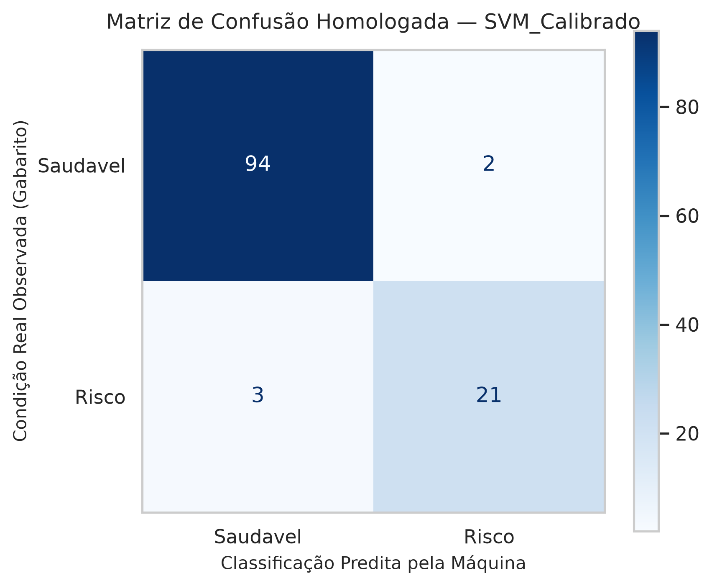
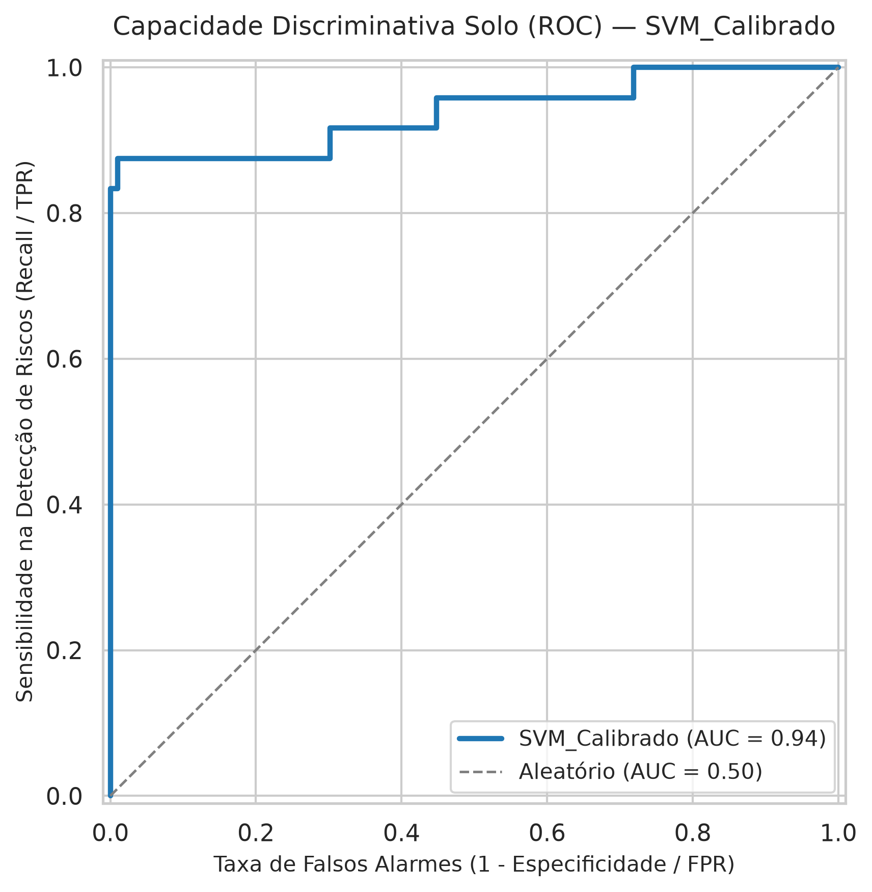
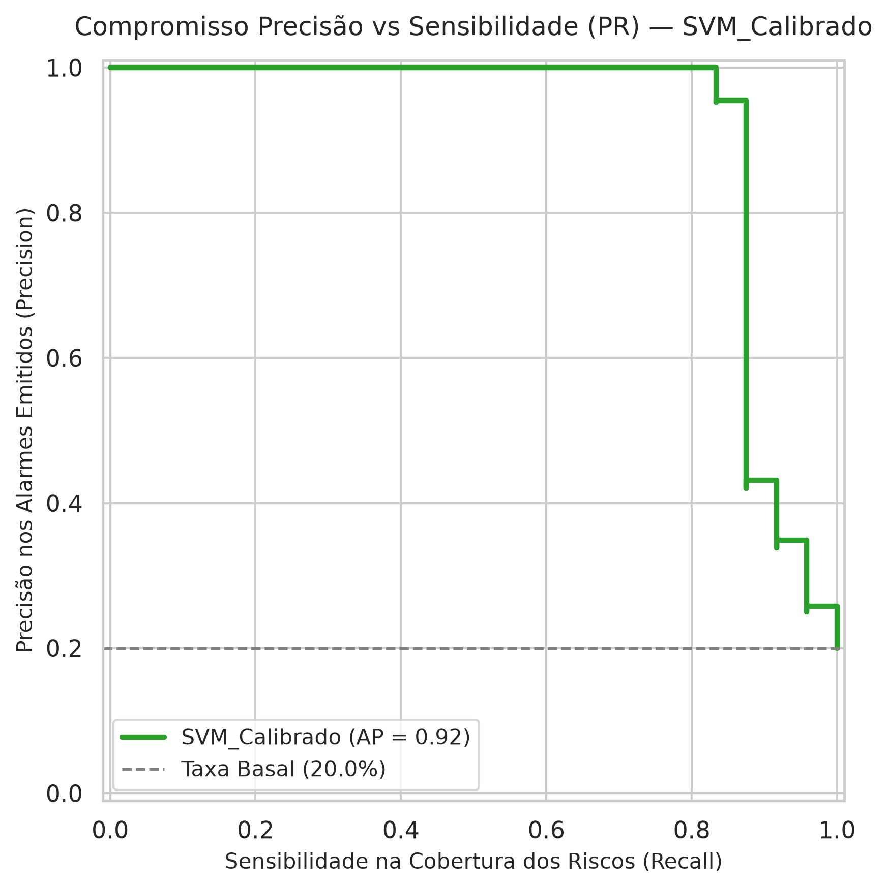
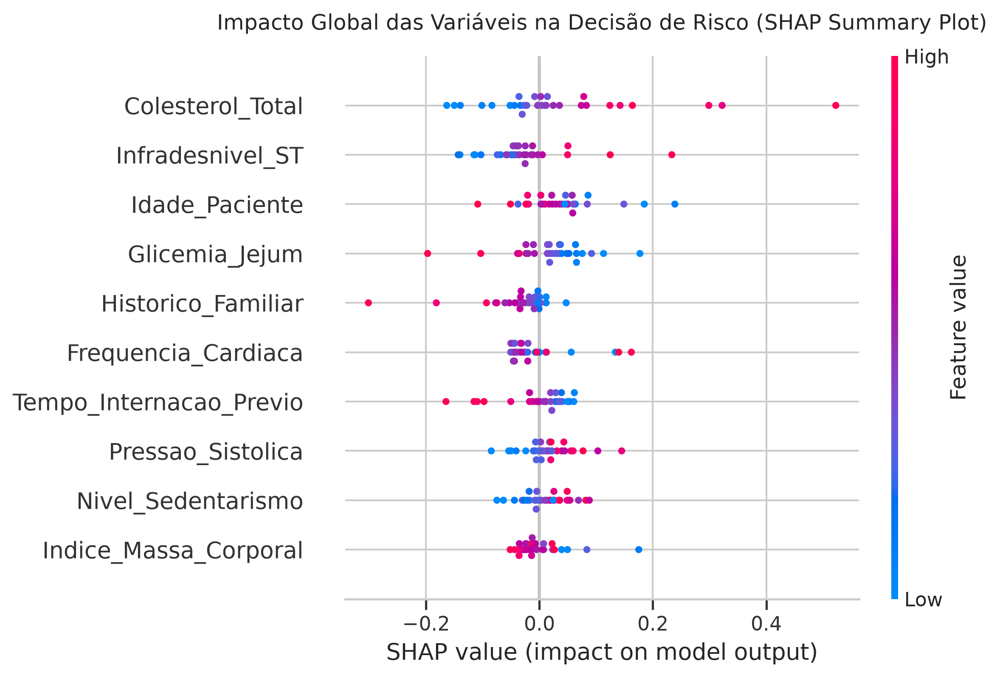
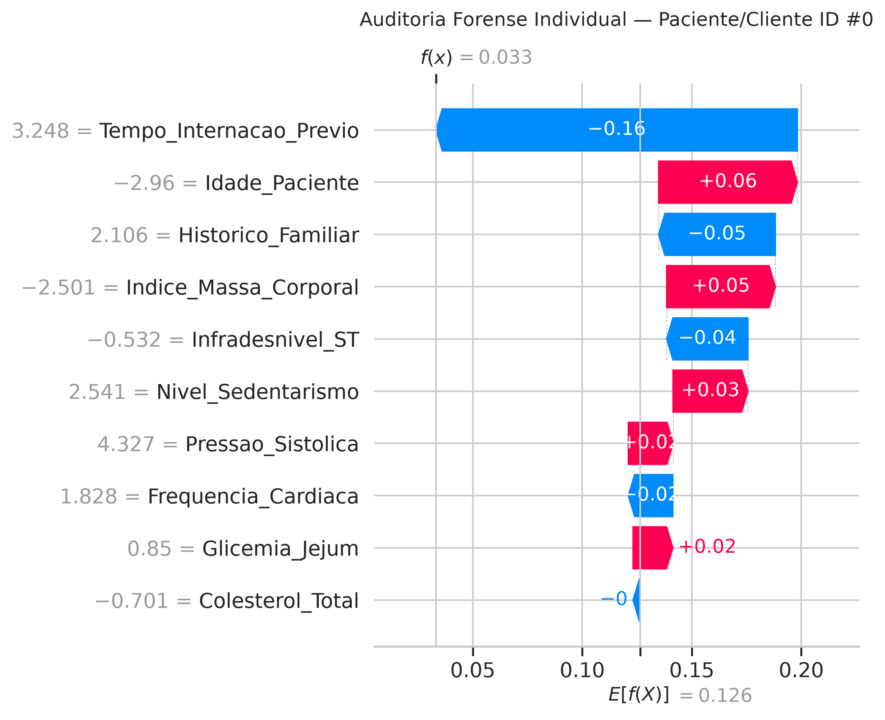

# 📋 DOSSIÊ EXECUTIVO DE HOMOLOGAÇÃO DE INTELIGÊNCIA ARTIFICIAL (FASE 5)

**Modelo Certificado para Produção:** `SVM_Calibrado`  
**Decisão da Junta Executiva:** `HOMOLOGADO PARA PRODUÇÃO`  
**Data da Auditoria:** 2026-10-26  
**Metodologia:** CRISP-DM — Autorização de Passagem para Fase 6 (Implantação)[cite: 22]

---

## 1. Parecer Pericial de Governança e Risco
> **Parecer Formal:** O estimador 'SVM_Calibrado' obteve sensibilidade de 87.50% (mínimo: 70.00%), latência de 0.0198 ms (máximo: 10.0 ms) e retorno líquido de R$ 46,800.00. Modelo aprovado por todos os critérios de governança e alinhado ao apetite a risco.[cite: 20]

### 1.1 Critérios Inegociáveis de Aceite Institucional
- **Sensibilidade Mínima (Mitigação de Negligência):** ✅ ATENDIDO[cite: 18, 20]
- **Latência Operacional em Tempo Real:** ✅ ATENDIDO[cite: 18]
- **Retorno Financeiro Líquido Estimado:** ✅ ATENDIDO[cite: 20]

---

## 2. Justificativa de Seleção: Arbitragem do Pódio (Top 3)
A tabela abaixo registra a evidência formal que fundamenta a escolha do modelo vencedor frente aos demais finalistas do torneio da Fase 4[cite: 20]:

| Modelo             |   F1_Score |   Sensibilidade_Recall |   Precisao |   ROC_AUC |   PR_AUC |   Latencia_Unit_ms |   Falsos_Negativos |   Falsos_Positivos |   Verdadeiros_Positivos |   Verdadeiros_Negativos |   Prejuizo_Negligencia_R$ |   Custo_Alarmes_R$ |   Perda_Total_Erros_R$ |   Valor_Preservado_R$ |   Resultado_Liquido_R$ | Variavel_Dominante_XAI   |   Baseline_Risco_Populacional |
|:-------------------|-----------:|-----------------------:|-----------:|----------:|---------:|-------------------:|-------------------:|-------------------:|------------------------:|------------------------:|--------------------------:|-------------------:|-----------------------:|----------------------:|-----------------------:|:-------------------------|------------------------------:|
| SVM_Calibrado      |   0.893617 |               0.875    |   0.913043 |  0.938368 | 0.916353 |          0.0198121 |                  3 |                  2 |                      21 |                      94 |                     36000 |               1200 |                  37200 |                 84000 |                  46800 | Colesterol_Total         |                       0.12643 |
| KNN_Classifier     |   0.844444 |               0.791667 |   0.904762 |  0.949219 | 0.906852 |          0.171793  |                  5 |                  2 |                      19 |                      94 |                     60000 |               1200 |                  61200 |                 76000 |                  14800 | Colesterol_Total         |                       0.12643 |
| XGBoost_Classifier |   0.809524 |               0.708333 |   0.944444 |  0.969184 | 0.916435 |          0.0802921 |                  7 |                  1 |                      17 |                      95 |                     84000 |                600 |                  84600 |                 68000 |                 -16600 | Colesterol_Total         |                       0.12643 |

---

## 3. Telemetria Técnica e Diagnóstico Solo do Campeão (`SVM_Calibrado`)
Os dados visuais abaixo pertencem **exclusivamente ao modelo homologado**, demonstrando seu comportamento limpo sem interferência de concorrentes descartados[cite: 18, 20]:

### 3.1 Matriz de Confusão Operacional
Demonstra o balanço de decisões do modelo campeão no conjunto de teste retido (Holdout Set)[cite: 18, 20]:

### 3.2 Curvas Discriminativas Individuais (ROC e Precision-Recall)
Comprovam a pureza discriminativa e o compromisso entre sensibilidade e precisão do estimador certificado[cite: 18, 20]:

---

## 4. Auditoria Forense e Explicabilidade Causal (SHAP — `SVM_Calibrado`)
Abertura da caixa-preta do modelo vencedor via Valores de Shapley (Teoria dos Jogos Cooperativos)[cite: 18, 20]:

### 4.1 Impacto Populacional Global (Beeswarm Plot)
- **Risco Basal Médio da População (Baseline E[f(x)]):** `12.64%`[cite: 18, 20]
- **Variável com Maior Peso Causal:** `Colesterol_Total`[cite: 18, 20]

### 4.2 Laudo Atômico Individual (Waterfall Plot)
Cumpre a exigência jurídica do **Direito à Explicação** (LGPD / Compliance), mostrando como cada variável atuou em um caso clínico específico[cite: 18, 20]:

---

## 5. Termo de Homologação e Assinaturas para Produção
Atestamos que o modelo campeão cumpre os requisitos de eficácia técnica, viabilidade financeira e conformidade ética.

| Autoridade de Governança | Papel / Função | Decisão Formal |
|---|---|---|
| **Dr. Arthur** | Cientista de Dados Staff / Líder Técnico | [x] Homologado Tecnicamente |
| **Diretoria de Operações** | Patrocinador Executivo de Negócios | [x] Aprovado Financeiramente |
| **Comitê de Risco e Ética** | Oficial de Compliance e Governança | [x] Auditado e Explicável |

**Próxima Etapa:** Autorizada a transição para a **Fase 6: Implantação (Deployment)** via API FastAPI conteinerizada[cite: 22].